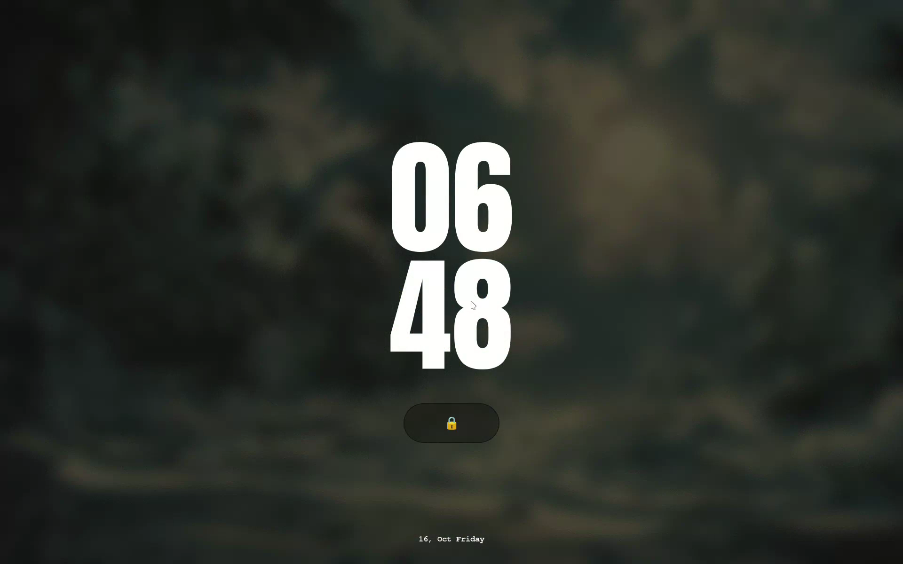
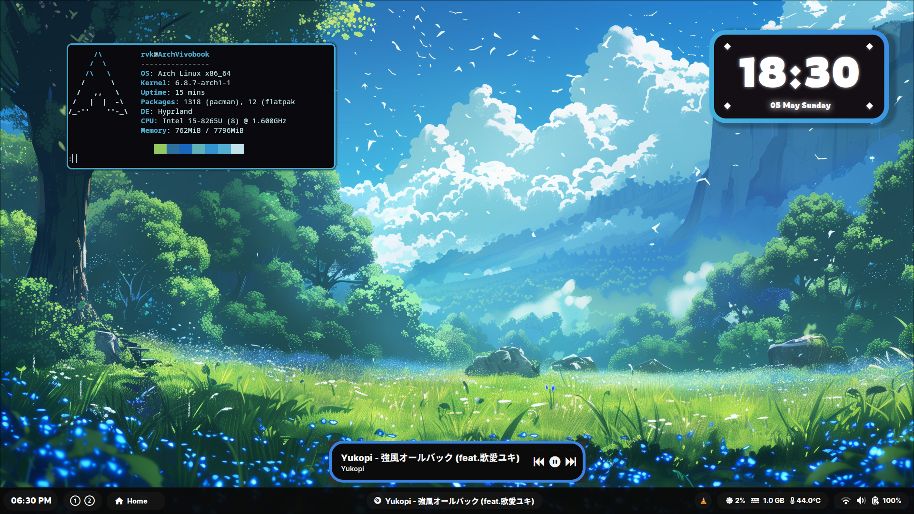
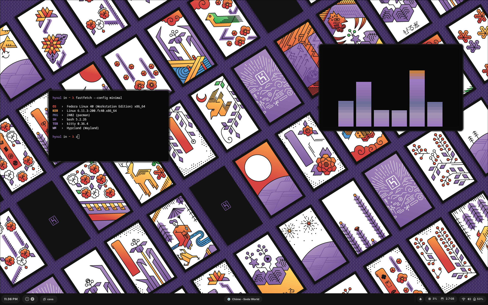
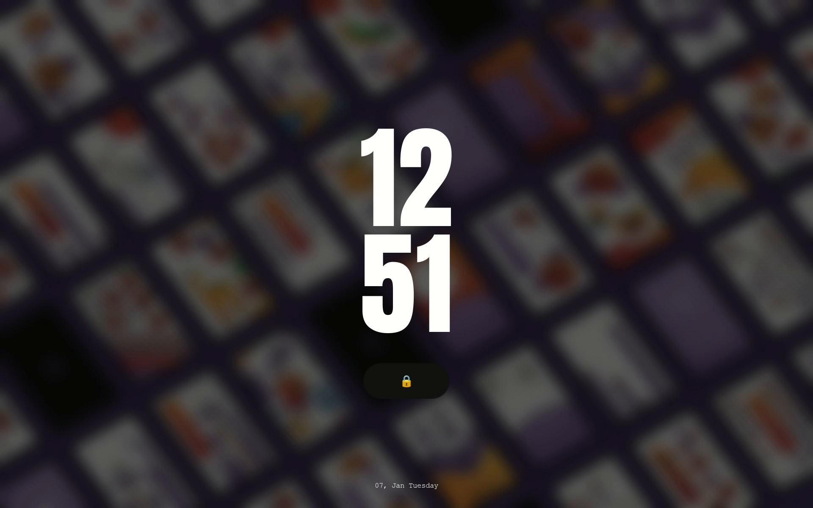

# Hyxal's Dotfiles

A collection of Linux dotfiles and desktop customizations built by **Hyxal V**.

## 🌊 Kadal — കടൽ

**The main configuration.**

### Components

- **Window Manager ⚙️** — [Hyprland](https://github.com/hyprwm/Hyprland)
- **Lockscreen 🔒** — [Hyprlock](https://github.com/hyprwm/hyprlock)
- **Widgets & Bar 🧩** — [Quickshell](https://quickshell.org/)
- **Launcher 🚀** — [Rofi](https://github.com/davatorium/rofi)
- **Notification Daemon 🔔** — [SwayNC](https://github.com/ErikReider/SwayNotificationCenter)
- **Terminal 🖥️** — [Kitty](https://github.com/kovidgoyal/kitty)
- **Wallpaper Manager 🖼️** — [SwayBG](https://github.com/swaywm/swaybg)

> **Note:** Fonts must be downloaded and installed manually. See the resources below.

---

## 📦 Archived Configurations

Previous configurations are preserved in the `Archive/` directory. They are no longer the primary focus of this repository.

### Neela — നീല

### Hanafuda — 花札

---

## 🔤 Fonts

- [Circle Font — PhotoshopSupply](https://www.photoshopsupply.com/fonts/circle-font)
- [Inter](https://fonts.google.com/specimen/Inter)
- [Rowdies](https://fonts.google.com/specimen/Rowdies)
- [Pixelify Sans](https://fonts.google.com/specimen/Pixelify+Sans)
- [Anton](https://fonts.google.com/specimen/Anton)
- **Font Awesome 6 Free** — Available through many Linux package managers.

## 🖼️ Wallpapers

- **Kadal** — [Moonlight in a Cloudy Sky over River and Trees](https://www.reddit.com/r/wallpaper/comments/zavfzl/moonlight_in_cloudy_sky_over_river_and_trees_3840/)
- **Neela** — [Wallpaper source](https://wall.alphacoders.com/big.php?i=1358522)
- **Hanafuda** — [Heroku Art](https://www.heroku.com/art/hanafuda)

## 🙏 Credits

- [adi1090x/rofi](https://github.com/adi1090x/rofi) — Rofi applets and inspiration.

---

*Built and customized by Hyxal V.*